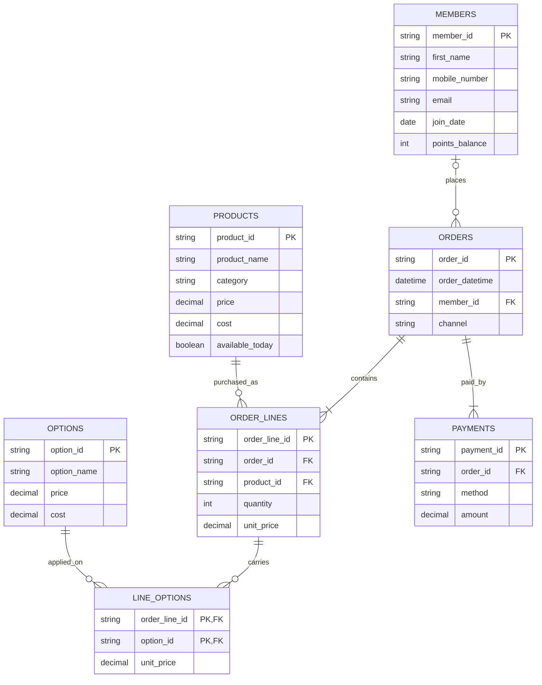

##C · Babson Bean Café

    
## One row of members is one loyalty member and their contact and points info.
## One row of products is one item on the menu.
## One row of options is one add-on a drink can carry.
## One row of orders is one order, placed by a member or not.
## One row of order_lines is one product ordered on one order.
## One row of line_options is one option charged on one order line.
## One row of payments is one amount paid toward one order.
